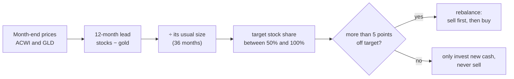

# MixStocks&Gold

**A small trading bot that holds world stocks and gold, and leans toward whichever has led for the past year.**
Backtested monthly since 1975. Trades through [Alpaca](https://alpaca.markets).

 


Once a month, the bot compares the last 12 months of world stocks (ACWI) and gold. The more stocks
have led, the closer it moves to **100% stocks**. The more gold has led, the closer it moves to **50/50**.
With no clear leader, it holds **80/20**. It trades only when the portfolio is more than 5 points off
that target.

## Results at a glance

Monthly backtest, March 1975 – September 2026, in USD, after 0.1% per trade:

| | per year | worst drop | worst 10 years | Sharpe |
|---|---:|---:|---:|---:|
| 100% world stocks | +11.2% | −52% | −1.2% / yr | 0.51 |
| Fixed 80% stocks / 20% gold | +10.7% | −41% | +1.9% / yr | 0.55 |
| The bot's *average* mix (81/19), held fixed | +10.7% | −42% | +1.5% / yr | 0.54 |
| **The bot** | **+11.5%** | **−29%** | **+5.0% / yr** | **0.58** |

It earns about the return of 100% stocks, with roughly half the worst crash, and its worst decade
still made money. The edge is mostly **crash insurance**: it shows up in long crises, when gold kept
rising for months (the late 1970s, 2000–2003, 2008). In strong bull markets it lags stocks by 1–2
points a year.

The third row isolates the timing. Holding the bot's average split all the time does no better than
a plain 80/20. The gain comes from *when* it holds more gold, not from holding gold.

## How it works

### Two ideas

**1. Stocks and gold rarely crash together.** A mix falls less than either part alone:

| | world stocks | gold |
|---|---:|---:|
| 2008 financial crisis | −59% | +15% |
| COVID crash, 2020 | −33% | −4% |
| 2022 bear market | −26% | −7% |
| 2025 tariff crash | −17% | +2% |

**2. Leaders tend to keep leading for a while.** This is momentum, one of the most documented effects
in markets, across stocks, bonds, currencies and commodities and over more than a century (see
[background reading](#background-reading)). Stocks and gold take long turns: stocks led in the 1980s,
1990s and 2010s, gold in the 1970s and 2000s.

### The rule

With $S$ the world-stock price and $G$ the gold price at month ends:

$$\text{lead}_t = \ln\frac{S_t}{S_{t-12}} - \ln\frac{G_t}{G_{t-12}}$$

$$z_t = \frac{\text{lead}_t}{\sqrt{12}\cdot\sigma_{36}\left(\Delta \ln S - \Delta \ln G\right)}$$

$$\text{stock share}_t = \begin{cases} 80\\% + 20\\% \cdot \tanh z_t & \text{if } z_t > 0 \text{ (stocks lead)} \\\\ 80\\% + 30\\% \cdot \tanh z_t & \text{if } z_t \le 0 \text{ (gold leads)} \end{cases}$$

The rest is gold.

- **lead:** how much better stocks did than gold over the last 12 months.
- **z:** that lead divided by its usual size, measured by how much the monthly difference between
  the two has swung over the last 3 years. A 20-point lead means little in a wild year and a lot in a
  calm one, so this makes the signal comparable across decades.
- **tanh:** turns z into a share smoothly. A small lead barely moves the mix, and a strong one
  saturates, so it never goes past 100/0 or 50/50. An on/off switch gave the same crash protection
  but traded 60–80% more, flipping 40 points on tiny leads.
- **80/20 centre, more room toward gold:** stocks have the higher long-run return, so the neutral mix
  leans to stocks. The extra room toward gold is where the crash protection comes from.


### Every month



### Why these settings

| choice | why |
|---|---|
| 12-month lookback | The standard in the momentum literature, not tuned. Lookbacks of 6 to 15 months all beat a fixed 80/20 by 0.4–1.0 points a year; 3 months broke even because it trades too much. All of them had a smaller worst drop. |
| 3-year "usual size" | Long enough to be stable, short enough to adapt from the calm 1990s to the wild 2000s. |
| smooth tanh, not on/off | Same protection, about half the trading, less whipsaw when the lead flips back and forth. |
| floor at 50/50 | Slightly better crash protection than a 60/40 floor (worst drop −29% vs −33%), with a bit more trading. |
| 5-point band | How you rebalance changes returns by less than 0.1 point a year, so the rule is chosen to trade rarely. |

## The backtest


Return per year by decade:

| | 1975–79 | 1980s | 1990s | 2000s | 2010s | 2020–26 |
|---|---:|---:|---:|---:|---:|---:|
| 100% world stocks | +14.8% | **+20.8%** | **+11.3%** | +1.7% | **+8.9%** | +12.8% |
| Fixed 80/20 | +17.1% | +17.0% | +8.5% | +4.8% | +7.8% | **+13.8%** |
| **The bot** | **+19.2%** | +18.5% | +9.2% | **+7.0%** | +7.4% | +12.9% |

**Does the start date matter?** Starting from every month since 1975:
- **Until today:** the bot beat a fixed 80/20 from 70% of start months, and 100% stocks from 69%.
- **Over the following 10 years:** it beat 100% stocks about half the time (52%).
- **Worst 10-year stretch:** +5.1% a year for the bot, against −1.2% for 100% stocks.


### Where the data comes from, and its limits

- **World stocks:** MSCI World until 1987 (developed countries only), then MSCI ACWI, from Yahoo
  Finance. Dividends are estimated from US data (Kenneth French's data library). Before 1988 this
  probably flatters stocks by 1–1.5 points a year, which works *against* the bot.
- **Gold:** monthly average prices (public series), minus 0.15% a year for a gold fund's fee. Gold
  has had a free market price since 1971. Before that, it was fixed at $35.
- **Cash:** US T-bills.
- **Monthly averages:** gold before 2000 only exists as monthly averages, so the backtest uses them
  for everything, which makes drops look smaller than they were day to day. Averaging also links
  neighbouring months, so the backtest uses a signal **one month older** than the live bot.
- **Not included:** taxes and currency effects. All numbers are in US dollars.
- **Small sample of crises:** the bot's edge comes mostly from about three long crises. That's real,
  but it rests on a handful of episodes, not hundreds of independent bets.

## Using it

```bash
git clone https://github.com/LouisJouret/MixStocksAndGold && cd MixStocksAndGold
uv sync                              # needs uv: https://docs.astral.sh/uv/
uv run pytest                        # offline tests
uv run trader backtest               # tables + charts in results/ (about 5 seconds)
uv run trader signal                 # this month's target, no broker needed
cp .env.example .env                 # then add your Alpaca paper keys
uv run trader rebalance              # dry run: shows the orders it would place
uv run trader rebalance --execute    # places them in the paper account
```

```
$ uv run trader signal
┃ month end ┃ ACWI 12 mo ┃ GLD 12 mo ┃ z     ┃ target ACWI ┃ target GLDM ┃
│ 2026-09   │ +16.6%     │ +7.1%     │ +0.41 │ 88%         │ 12%         │
Target for this month (from prices up to 2026-09-30): 87.8% ACWI, 12.2% GLDM.
```

**What `rebalance` does:**
1. Computes the target from Yahoo prices of ACWI and GLD up to the last month end.
2. Reads the Alpaca account. Positions in other symbols are left alone.
3. More than 5 points off target: sells first, then buys with what the sells freed. At most one
   rebalance a month.
4. Otherwise: only invests idle cash (new deposits), giving the fund that's below target more of the
   money, and never sells.
5. Keeps 0.5% in cash, sends market orders only during US market hours, and does nothing while
   earlier orders are still open.
6. Logs every run to `results/bot_log.csv`.

It uses the paper account by default. Real money needs separate `ALPACA_LIVE_*` keys **and**
`--live --execute`.

**Run it automatically (macOS):** a launchd job runs `rebalance --execute` every weekday at 16:00
local time. That's 10:00 in New York if you're in Central Europe; change the hour in the file
otherwise. If the Mac is asleep then, the job runs when it wakes.

```bash
sed -e "s#__REPO__#$PWD#g" -e "s#__HOME__#$HOME#g" -e "s#__UV__#$(which uv)#g" -e "s#__UVDIR__#$(dirname $(which uv))#g" \
    launchd/com.trader.rebalance.plist > ~/Library/LaunchAgents/com.trader.rebalance.plist
launchctl bootstrap gui/$(id -u) ~/Library/LaunchAgents/com.trader.rebalance.plist   # start
launchctl bootout gui/$(id -u)/com.trader.rebalance                                  # stop
tail -f ~/Library/Logs/trader-bot.log                                                # watch
```

All settings (funds, the rule, band, cash buffer, backtest costs) live in [`config.yaml`](config.yaml).

| file | what it does |
|---|---|
| [`trader/tilt.py`](trader/tilt.py) | the rule and the trade planning, broker-free and tested |
| [`trader/broker.py`](trader/broker.py) | Alpaca: account, positions, orders |
| [`trader/backtest.py`](trader/backtest.py) | the 1972–today monthly history, simulation, charts |
| [`trader/data.py`](trader/data.py) | Yahoo prices, Kenneth French's data, the gold series (cached in `data/`) |
| [`trader/cli.py`](trader/cli.py) | the `signal`, `rebalance` and `backtest` commands |

## Background reading

The pieces are well studied. This particular combination is not a published strategy.

- Moskowitz, Ooi & Pedersen (2012), *Time Series Momentum*, Journal of Financial Economics: the
  12-month lookback, signals scaled by volatility.
- Asness, Moskowitz & Pedersen (2013), *Value and Momentum Everywhere*, Journal of Finance: momentum
  across asset classes.
- Hurst, Ooi & Pedersen (2017), *A Century of Evidence on Trend-Following Investing*: trend following
  since 1880.
- Faber (2007), *A Quantitative Approach to Tactical Asset Allocation*, and Antonacci (2014), *Dual
  Momentum Investing*: simple momentum rules for whole asset classes.
- Baz, Granger, Harvey, Le Roux & Rattray (2015), *Dissecting Investment Strategies in the Cross
  Section and Time Series*: smooth response curves for momentum signals.
- Baur & Lucey (2010), *Is Gold a Hedge or a Safe Haven?*, and Erb & Harvey (2013), *The Golden
  Dilemma*: gold in crises, and gold's long-run value.
- McLean & Pontiff (2016), *Does Academic Research Destroy Stock Return Predictability?*: published
  effects weaken after publication. Momentum has been weaker since about 2010.

## Disclaimer

This is a personal research project, **not financial advice**. Backtests are hypothetical: they use
reconstructed data and assumptions, and include choices made after looking at the past. Real
results will differ. The bot can place real orders if you give it live keys and `--live`. Run it on
paper first, and only with money you can afford to lose.

Before trading real money, check that you may buy US-listed funds where you live (EU residents
usually can't), and how they're taxed for you. US-listed funds can carry US estate tax for non-US
residents. Use at your own risk.

[MIT license](LICENSE)
