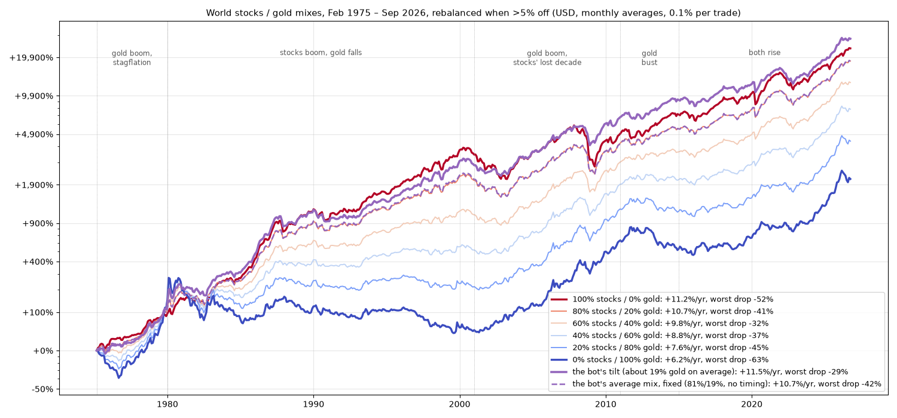
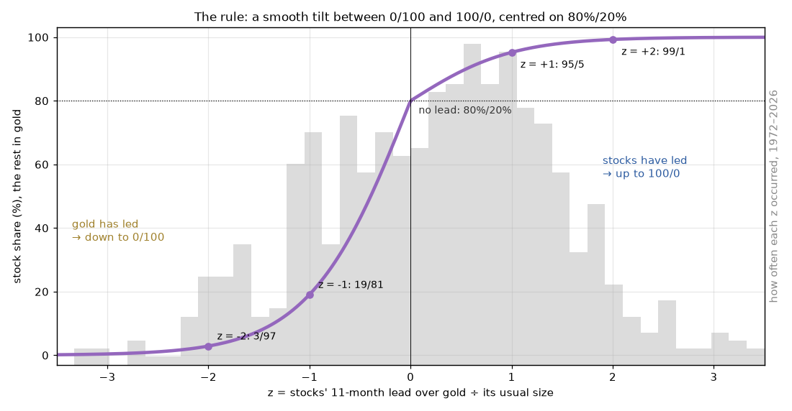
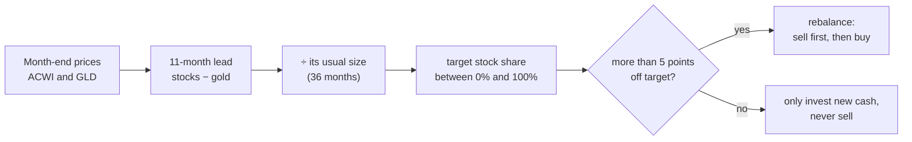
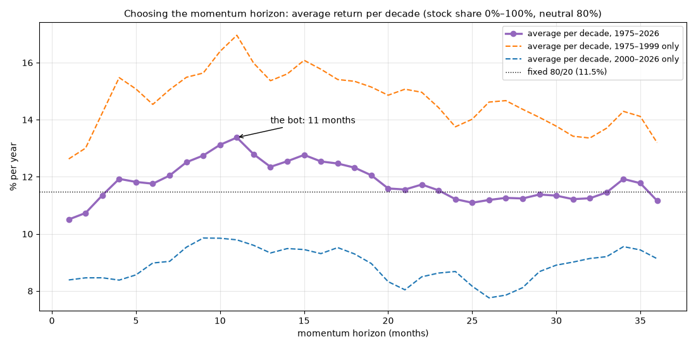
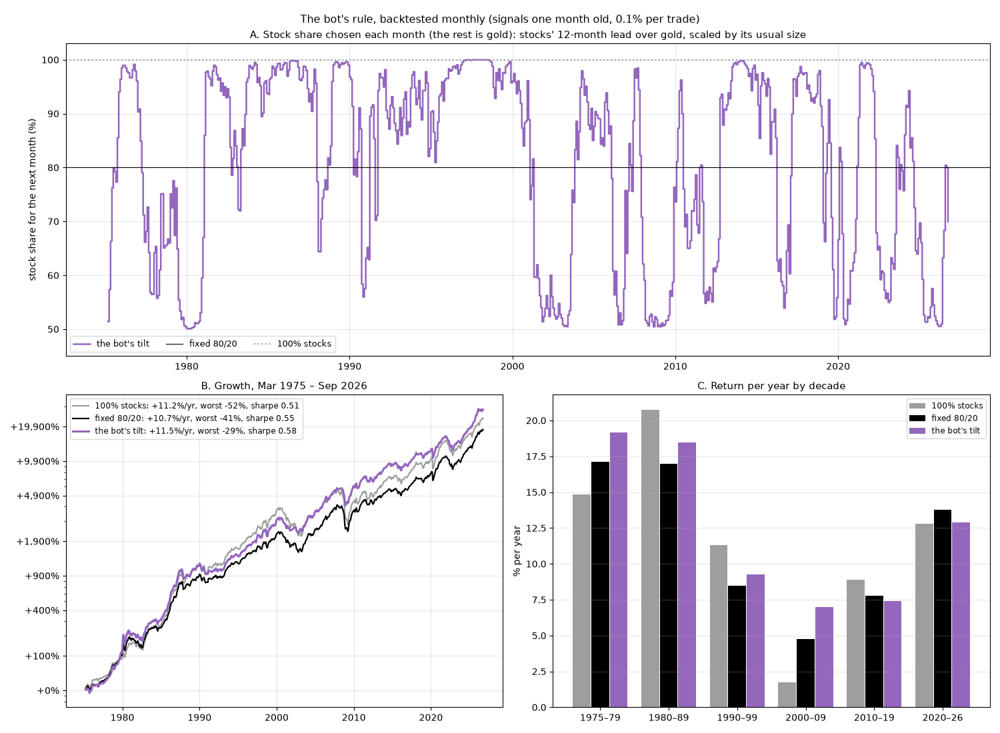
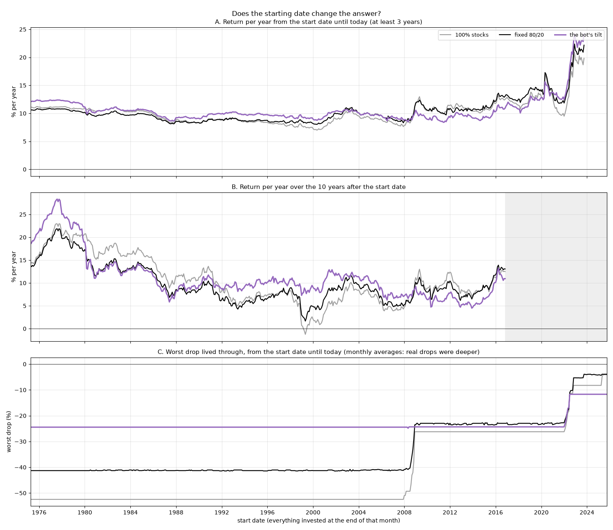

# MixStocks&Gold

**A small trading bot that holds world stocks and gold, and leans toward whichever has led for the past year.**
Backtested monthly since 1975. Trades through [Alpaca](https://alpaca.markets).

 



Once a month, the bot compares the last 11 months of world stocks (ACWI) and gold. The more stocks
have led, the closer it moves to **100% stocks**. The more gold has led, the closer it moves to **100%
gold**. With no clear leader, it holds **80/20**. It trades only when the portfolio is more than 5
points off that target.

## Results at a glance

Monthly backtest, March 1975 – September 2026, in USD, after 0.1% per trade:

| | per year | worst drop | worst 10 years | Sharpe |
|---|---:|---:|---:|---:|
| 100% world stocks | +11.2% | −52% | −1.2% / yr | 0.51 |
| Fixed 80% stocks / 20% gold | +10.7% | −41% | +1.9% / yr | 0.55 |
| The bot's *average* mix (74/26), held fixed | +10.5% | −38% | +2.6% / yr | 0.54 |
| **The bot** | **+12.1%** | **−24%** | **+4.4% / yr** | **0.56** |

It beats 100% stocks by about 0.9 points a year, with half the worst crash, and its worst decade
still made money. The edge comes from long crises, when gold kept rising for months (the late
1970s, 2000–2003, 2008). In strong bull markets it lags stocks by 2–3 points a year.

The third row isolates the timing. Holding the bot's average split all the time earns 1.6 points a
year less. The gain comes from *when* it holds gold, not from how much.

## How it works

### Two ideas

**1. Stocks and gold rarely crash together.** A mix falls less than either part alone:

| | world stocks | gold |
|---|---:|---:|
| 2008 financial crisis | −59% | +15% |
| COVID crash, 2020 | −33% | −4% |
| 2022 bear market | −26% | −7% |
| 2025 tariff crash | −17% | +2% |

**2. Leaders tend to keep leading for a while.** This is momentum, one of the most documented effects
in markets, across stocks, bonds, currencies and commodities and over more than a century (see
[background reading](#background-reading)). Stocks and gold take long turns: stocks led in the 1980s,
1990s and 2010s, gold in the 1970s and 2000s.

### The rule

With $S$ the world-stock price and $G$ the gold price at month ends:

$$\text{lead}_t = \ln\frac{S_t}{S_{t-11}} - \ln\frac{G_t}{G_{t-11}}$$

$$z_t = \frac{\text{lead}_t}{\sqrt{12}\cdot\sigma_{36}\left(\Delta \ln S - \Delta \ln G\right)}$$

$$\text{stock share}_t = 50\\% + 50\\% \cdot \tanh\left(z_t + s\right), \qquad s = \mathrm{atanh}(2 \cdot 80\\% - 1) \approx 0.69$$

The rest is gold.

- **lead:** how much better stocks did than gold over the last 11 months.
- **z:** that lead divided by its usual size, measured by how much the monthly difference between
  the two has swung over the last 3 years. A 20-point lead means little in a wild year and a lot in a
  calm one, so this makes the signal comparable across decades.
- **tanh:** one smooth S-curve from all gold to all stocks. A small lead barely moves the mix, and a
  strong one saturates: z = +1 gives 97% stocks, z = −1 gives 35%, z = −2 gives 7%. An on/off
  switch gave similar crash protection but traded much more, flipping on tiny leads.
- **s, the 80/20 centre:** shifts the curve so that with no lead it holds 80% stocks. Stocks have the
  higher long-run return, so the neutral mix leans to stocks. Going all the way to gold when gold
  clearly leads is where the crash protection comes from.



### Every month



## Choosing the settings

Three things were checked on the data: the **momentum horizon**, the **stock limits**, and the
**shape and centre** of the curve. Everything else uses standard values (a 3-year window, a 5-point
band).

### The momentum horizon

Every horizon from 1 to 36 months was backtested with the same limits (0–100% stocks), the same
start month and the same costs. Each was scored by its average return per decade, so every decade
counts equally:



| horizon | per decade | 1975–1999 only | 2000–2026 only | worst drop | traded per year |
|---|---:|---:|---:|---:|---:|
| 3 months | +11.3% | +14.5% | +8.2% | −38% | 198% |
| 6 months | +11.7% | +15.1% | +8.3% | −40% | 169% |
| 9 months | +12.5% | +16.2% | +8.9% | −28% | 147% |
| **11 months** | **+13.4%** | **+17.5%** | +9.3% | −24% | 126% |
| 12 months | +12.8% | +16.5% | +9.2% | −24% | 122% |
| 15 months | +12.4% | +16.0% | +8.7% | −30% | 122% |
| 18 months | +12.0% | +15.2% | +8.8% | −35% | 120% |
| 24 months | +10.9% | +13.9% | +8.0% | −41% | 98% |
| 36 months | +11.3% | +13.4% | +9.2% | −47% | 68% |
| *fixed 80/20* | *+11.5%* | | | *−41%* | *5%* |

- **Too short (1–6 months):** it reacts to noise. It flips back and forth, trades up to twice the
  portfolio a year, and does no better than a fixed 80/20.
- **Too long (20+ months):** it reacts too late. It's still in stocks when a crash starts, so the
  worst drop grows to −41% to −47%.
- **Sweet spot, about 9–12 months:** long enough to ignore noise, short enough to move to gold early
  in a long crisis. 11 months scored best.
- **The halves mostly agree.** Chosen on 1975–1999 alone, the best horizon would also have been
  11 months, and it ranked 3rd of 36 on 2000–2026. That second half is fairly flat on its own (7.5–
  9.5% per decade for every horizon). Its nominal best, 35 months, is only 0.2 points ahead of
  11 months, and 11 is the peak of its 8–15-month hump.
- **11 vs 12 months is within noise:** the curve wobbles by about 0.4 points from one month to the
  next. The finding is "about 9 to 12 months", which includes the 12 months common in the
  literature.

Run `uv run trader backtest` to redraw this chart (`results/horizon.png`) with the latest data.

### The stock limits

A search over the upper limit (80–100% stocks), the lower limit (0–80%) and the horizon (with the
earlier two-part curve, see below) found that
the **lower limit matters most**. The lower it was, the better, at every horizon from 9 to 15
months. At 11 months, going down to 0% stocks (all gold) when gold clearly leads beat a 50% floor
by 0.7 points per decade (+13.4% vs +12.7%), with a smaller worst drop (−25% vs −30%). Settings
chosen on one half of the history also did well on the other.

The catch: this gain comes from the two gold booms (late 1970s: +25.8% a year vs +20.6% with a 50%
floor; 2000s: +10.5% vs +6.9%). It costs 0.7–1.6 points a year in every other decade, and more than
doubles the trading (141% of the portfolio a year vs 64%).

### The shape of the curve and its centre

The first version joined two tanh halves at 80/20: 20 points of room toward stocks and 80 toward
gold. That made the curve four times steeper on the gold side, with a corner at 80/20. The
current version is one smooth S-curve from 0% to 100%, shifted so it passes through the chosen
centre when neither leads. Scanning that centre (11 months):

| curve | per decade | 1975–1999 only | 2000–2026 only | worst drop | traded per year |
|---|---:|---:|---:|---:|---:|
| two halves with a corner, 80/20 | +13.38% | +17.0% | +9.8% | −25% | 141% |
| smooth, centre 50% | +13.22% | +15.8% | +10.6% | −28% | 160% |
| smooth, centre 60% | +13.33% | +16.5% | +10.2% | −26% | 154% |
| smooth, centre 70% | +13.38% | +16.9% | +9.8% | −24% | 142% |
| **smooth, centre 80%** | **+13.38%** | +17.5% | +9.3% | **−24%** | **126%** |
| smooth, centre 90% | +13.13% | +17.7% | +8.6% | −28% | 104% |

- **The centre barely matters:** anywhere from 60% to 85% gives the same return per decade, within
  0.05 points. Only the extremes are worse.
- **The halves disagree on it:** a higher centre helped in 1975–1999, when stocks mostly led, and a
  lower one in 2000–2026. Choosing it is a bet on which asset will lead, so the data can't settle it.
- **80% was chosen for practical reasons:** the same return as the cornered curve, a slightly better
  worst drop and Sharpe ratio, about 10% less trading, and one setting instead of three.

### Why nothing else was tuned

A search over all seven settings found combinations that looked even better (up to +14% per
decade). But they didn't hold up:
- **They failed the halves test.** Across all combinations, the scores in 1975–1999 and 2000–2026
  were *negatively* related: settings that did well in one half tended to do worse than average in
  the other.
- **They failed the luck test.** The same search run on shuffled histories, where the months are in
  random order so no momentum can exist, still "found" settings beating 80/20 by about 1 point a
  year, and up to 4.5 points. A big search always finds a winner.

The horizon and limits held up far better on the halves test. Their gain over 80/20 (+2.3 points per decade) is
also well above what luck produced in the same search on shuffled histories (+0.75 on average),
though one shuffled history in twenty did better. The original 12-month rule, set before any tuning,
beat 80/20 by more than in any of the 20 shuffled histories, which is evidence that the momentum
effect itself is real here.

## The backtest



Return per year by decade:

| | 1975–79 | 1980s | 1990s | 2000s | 2010s | 2020–26 |
|---|---:|---:|---:|---:|---:|---:|
| 100% world stocks | +14.8% | **+20.8%** | **+11.3%** | +1.7% | **+8.9%** | +12.8% |
| Fixed 80/20 | +17.1% | +17.0% | +8.5% | +4.8% | +7.8% | **+13.8%** |
| **The bot** | **+25.1%** | +17.8% | +9.5% | **+8.8%** | +6.3% | +12.8% |

**Does the start date matter?** Starting from every month since 1975:
- **Until today:** the bot beat 100% stocks from 72% of start months, and a fixed 80/20 from 68%.
- **Over the following 10 years:** it beat 100% stocks about half the time (52%), and 80/20 62% of
  the time.
- **Worst 10-year stretch:** +4.5% a year for the bot, against −1.2% for 100% stocks.



### Where the data comes from, and its limits

- **World stocks:** MSCI World until 1987 (developed countries only), then MSCI ACWI, from Yahoo
  Finance. Dividends are estimated from US data (Kenneth French's data library). Before 1988 this
  probably flatters stocks by 1–1.5 points a year, which works *against* the bot.
- **Gold:** monthly average prices (public series), minus 0.15% a year for a gold fund's fee. Gold
  has had a free market price since 1971. Before that, it was fixed at $35.
- **Cash:** US T-bills.
- **Monthly averages:** gold before 2000 only exists as monthly averages, so the backtest uses them
  for everything, which makes drops look smaller than they were day to day. Averaging also links
  neighbouring months, so the backtest uses a signal **one month older** than the live bot.
- **Not included:** taxes and currency effects. All numbers are in US dollars.
- **Small sample of crises:** the bot's edge comes mostly from a few long crises and two big gold
  booms. That's real, but it rests on a handful of episodes, not hundreds of independent bets.

## Using it

```bash
git clone https://github.com/LouisJouret/MixStocksAndGold && cd MixStocksAndGold
uv sync                              # needs uv: https://docs.astral.sh/uv/
uv run pytest                        # offline tests
uv run trader backtest               # tables + charts in results/ (add --docs to refresh docs/)
uv run trader signal                 # this month's target, no broker needed
cp .env.example .env                 # then add your Alpaca paper keys
uv run trader rebalance              # dry run: shows the orders it would place
uv run trader rebalance --execute    # places them in the paper account
```

```
$ uv run trader signal
┃ month end ┃ ACWI 11 mo ┃ GLD 11 mo ┃ z     ┃ target ACWI ┃ target GLDM ┃
│ 2026-09   │ +14.0%     │ +3.5%     │ +0.47 │ 91%         │ 9%          │
Target for this month (from prices up to 2026-09-30): 91.2% ACWI, 8.8% GLDM.
```

**What `rebalance` does:**
1. Computes the target from Yahoo prices of ACWI and GLD up to the last month end.
2. Reads the Alpaca account. Positions in other symbols are left alone.
3. More than 5 points off target: sells first, then buys with what the sells freed. At most one
   rebalance a month.
4. Otherwise: only invests idle cash (new deposits), giving the fund that's below target more of the
   money, and never sells.
5. Keeps 0.5% in cash, sends market orders only during US market hours, and does nothing while
   earlier orders are still open.
6. Logs every run to `results/bot_log.csv`.

It uses the paper account by default. Real money needs separate `ALPACA_LIVE_*` keys **and**
`--live --execute`.

**Run it automatically (macOS):** a launchd job runs `rebalance --execute` every weekday at 16:00
local time. That's 10:00 in New York if you're in Central Europe; change the hour in the file
otherwise. If the Mac is asleep then, the job runs when it wakes.

```bash
sed -e "s#__REPO__#$PWD#g" -e "s#__HOME__#$HOME#g" -e "s#__UV__#$(which uv)#g" -e "s#__UVDIR__#$(dirname $(which uv))#g" \
    launchd/com.trader.rebalance.plist > ~/Library/LaunchAgents/com.trader.rebalance.plist
launchctl bootstrap gui/$(id -u) ~/Library/LaunchAgents/com.trader.rebalance.plist   # start
launchctl bootout gui/$(id -u)/com.trader.rebalance                                  # stop
tail -f ~/Library/Logs/trader-bot.log                                                # watch
```

All settings (funds, the rule, band, cash buffer, backtest costs) live in [`config.yaml`](config.yaml).

| file | what it does |
|---|---|
| [`trader/tilt.py`](trader/tilt.py) | the rule and the trade planning, broker-free and tested |
| [`trader/broker.py`](trader/broker.py) | Alpaca: account, positions, orders |
| [`trader/backtest.py`](trader/backtest.py) | the 1972–today monthly history, simulation, the horizon scan, charts |
| [`trader/data.py`](trader/data.py) | Yahoo prices, Kenneth French's data, the gold series (cached in `data/`) |
| [`trader/cli.py`](trader/cli.py) | the `signal`, `rebalance` and `backtest` commands |

## Background reading

The pieces are well studied. This particular combination is not a published strategy.

- Moskowitz, Ooi & Pedersen (2012), *Time Series Momentum*, Journal of Financial Economics: the
  12-month lookback, signals scaled by volatility.
- Asness, Moskowitz & Pedersen (2013), *Value and Momentum Everywhere*, Journal of Finance: momentum
  across asset classes.
- Hurst, Ooi & Pedersen (2017), *A Century of Evidence on Trend-Following Investing*: trend following
  since 1880.
- Faber (2007), *A Quantitative Approach to Tactical Asset Allocation*, and Antonacci (2014), *Dual
  Momentum Investing*: simple momentum rules for whole asset classes.
- Baz, Granger, Harvey, Le Roux & Rattray (2015), *Dissecting Investment Strategies in the Cross
  Section and Time Series*: smooth response curves for momentum signals.
- Baur & Lucey (2010), *Is Gold a Hedge or a Safe Haven?*, and Erb & Harvey (2013), *The Golden
  Dilemma*: gold in crises, and gold's long-run value.
- McLean & Pontiff (2016), *Does Academic Research Destroy Stock Return Predictability?*: published
  effects weaken after publication. Momentum has been weaker since about 2010.

## Disclaimer

This is a personal research project, **not financial advice**. Backtests are hypothetical: they use
reconstructed data and assumptions, and include choices made after looking at the past. Real
results will differ. The bot can hold 100% gold, which has had drops of −45% to −63% in the past.
It can place real orders if you give it live keys and `--live`. Run it on paper first, and only with
money you can afford to lose.

Before trading real money, check that you may buy US-listed funds where you live (EU residents
usually can't), and how they're taxed for you. US-listed funds can carry US estate tax for non-US
residents. Use at your own risk.

[MIT license](LICENSE)
